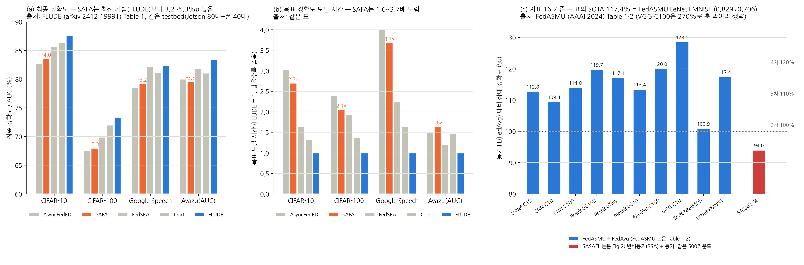

# SASAFL을 쓸 것인가, SOTA를 쓸 것인가 — 성능지표 14·15·16 기준 판단 근거

작성일: 2026-10-14. 근거는 세 가지다.
- 논문 본문: SASAFL (Yu et al., JPDC 2024)
- 이 저장소의 코드
- 본 실험 결과: `k30_reproduction/`(K=30 재현), `crash_study/`(장애 주입)

---

## 1. SASAFL과 SAFA의 동작 차이 (global loss 기반 adaptive quota 제외)

| 구분 | SAFA (Wu et al., IEEE TC 2021) | SASAFL (Yu et al., JPDC 2024) |
|---|---|---|
| 라운드 종료 조건 | **deadline**. 가장 느린 클라이언트의 시간 또는 사용자가 정한 T_lim에서 라운드를 끊는다 | **deadline 없음**. 버퍼에 Pᵣ개가 쌓일 때까지 기다린다 |
| 집계에 쓰는 모델 | **cache 전체**. 클라이언트마다 마지막 모델을 서버 cache에 두고, 매 라운드 cache 전체를 데이터 크기 비율로 평균한다 | **이번 버퍼에 들어온 모델만**. 개수가 Pᵣ를 넘어도 버퍼에 있는 것은 전부 쓴다 |
| 클라이언트 선택 | **CFCFM**(compensatory first-come-first-merge). 직전 라운드에 뽑히지 않은 클라이언트를 우선하고, 할당량 C·K를 넘는 모델은 "undrafted"로 cache에만 반영한다 | 선택 단계가 없다. 도착한 순서대로 버퍼에 넣는다 |
| 오래된(stale) 모델 처리 | lag tolerance τ를 넘은 클라이언트에게 최신 모델을 강제로 주고 cache를 덮어쓴다. 나머지 stale 모델은 cache에서 **그대로** 쓴다 | 집계 전에 **staleness 감쇠 보간**(Eq.2: ζ^s·w_k + (1−ζ^s)·w_r, ζ=0.9)을 한다 |
| 글로벌 모델 배포 | 차등 배포: deprecated(τ 초과)와 최신 클라이언트에게만 보내고, 적당히 느린 클라이언트는 계속 학습한다 | **전체 클라이언트에게 매 라운드** 보낸다. 받을지 말지는 클라이언트가 정한다 (아래 행) |
| 클라이언트의 수신 정책 | 없음 (서버가 정함) | τ 초과면 교체한다. τ 이하이면서 **새 global loss가 더 낮을 때만 교체**한다(inferior-tolerable). 아니면 학습을 계속한다(superior-tolerable). *global loss를 쓰지만 adaptive quota와는 별개의 기능이다* |
| 교체 후 로컬 학습량 | 그대로 | 교체될 때마다 local epoch을 1씩 줄인다 (최소 E/2) |
| **crash 처리** | **있음**. crash된 클라이언트는 그 라운드에서 빠지고, cache에 남은 마지막 모델이 집계에 계속 기여한다 | **없음**. 논문 p.8: "Unlike SASAFL, SAFA considers crashed clients". 살아 있는 클라이언트 수가 Pᵣ보다 적으면 서버가 영원히 기다린다 (`crash_study` E2, E3) |

이 저장소 구현에 대한 주의:
- SAFA 구현: 클라이언트가 받은 글로벌 모델을 실제로 적용하지 않는다. 집계 계수 정규화도 빠져 있다. 따라서 Fig.6의 SAFA 결과는 논문의 SAFA라고 보기 어렵다.
- SASAFL 구현: 학습 도중 모델을 교체해도 optimizer가 이전 모델의 파라미터를 계속 갱신한다.

---

## 2. 성능지표 3개와 SASAFL의 대응 관계

| 지표 | 목표 (2·3·4차년도) | 비교 기준 (SOTA) | SASAFL에 해당 기능이 있는가 | 근거 |
|---|---|---|---|---|
| **14. 집계 uplink 통신량** (정규화) | ≤1.0 / ≤0.95 / ≤0.90 | SPATL = 1.0 (SC 2022). 선택된 salient 파라미터만 전송하고, 기존 대비 통신량을 최대 86.45% 줄였다고 보고 | **없음**. 매 업로드마다 전체 모델(MNIST CNN 1.66M 파라미터 = 6.65MB)을 보낸다 | 아래 3-1의 실측: 같은 목표 정확도까지 BSA보다 1.2~3.0배 많이 업로드 |
| **15. 학습 중단·재시작 시 gradient 보존율** | 100% / 100% / 100% | 없음 | **없음**. 체크포인트도 재개 기능도 없다 | `crash_study` E1b: 재시작하면 라운드 0부터 다시 시작하고 상태를 모두 잃는다. E1·E2: 차량 1대만 장애가 나도 job 전체가 종료되거나 멈춘다 |
| **16. staleness 필터링 시 동기 FL 대비 글로벌 모델 상대 정확도** | 100% / 110% / 120% | FedASMU 117.4% (AAAI 2024) | **일부 있음**. lag tolerance와 감쇠 보간이 staleness 필터링에 해당한다. 다만 논문은 동기 FL(FedAvg)과 정확도를 비교하지 않았다 | 아래 3-2 |

---

## 3. 객관적 근거 (측정값)

### 3-1. uplink 통신량: SASAFL vs BSA (본 실험, K=30, 175 단일 노드, 1회)

집계 1회당 업로드 수:

| 데이터셋 | C | BSA | SASAFL | SASAFL / BSA |
|---|---:|---:|---:|---:|
| MNIST | 0.1 | 3.00 | 5.32 | 1.77배 |
| MNIST | 0.3 | 9.00 | 12.79 | 1.42배 |
| MNIST | 0.5 | 15.00 | 17.77 | 1.18배 |
| FashionMNIST | 0.1 | 3.00 | 5.30 | 1.77배 |
| FashionMNIST | 0.3 | 9.00 | 12.09 | 1.34배 |
| FashionMNIST | 0.5 | 15.00 | 21.60 | 1.44배 |
| CIFAR-10 | 0.1 | 3.00 | 5.81 | 1.94배 |
| CIFAR-10 | 0.3 | 9.00 | 10.05 | 1.12배 |

목표 정확도까지의 총 업로드 수 = (목표 도달 라운드) × (라운드당 업로드), 두 방법이 모두 도달한 칸만 계산:

| 설정 | BSA | SASAFL | SASAFL / BSA |
|---|---:|---:|---:|
| MNIST C=0.1 | 261 × 3 = 783 | 447 × 5.32 ≈ 2,378 | **3.0배** |
| MNIST C=0.3 | 86 × 9 = 774 | 81 × 12.79 ≈ 1,036 | **1.3배** |
| MNIST C=0.5 | 48 × 15 = 720 | 71 × 17.77 ≈ 1,262 | **1.8배** |
| FashionMNIST C=0.5 | 118 × 15 = 1,770 | 98 × 21.6 ≈ 2,117 | **1.2배** |

여기에 더해 SASAFL은 **매 라운드 30대 전체에 글로벌 모델을 보낸다**(다운링크). BSA는 업로드한 클라이언트에게만 보낸다.
→ **SASAFL은 구조적으로 통신량을 늘리는 쪽이다. SPATL 기준 ≤1.0을 맞추려면 SASAFL과 별개로 압축·희소화 모듈이 필요하다.**

### 3-2. 정확도: SASAFL vs BSA (본 실험) — 지표 16과 관련

최고 정확도 비교:

| | MNIST BSA / SASAFL | FashionMNIST BSA / SASAFL | CIFAR-10 (500R) BSA / SASAFL |
|---|---|---|---|
| C=0.1 | **96.90** / 95.18 | **63.64** / 59.72 | 36.50 / **38.28** |
| C=0.3 | 98.28 / **98.53** | **74.50** / 69.93 | **47.92** / 44.35 |
| C=0.5 | **98.86** / 98.84 | 79.57 / **81.36** | **52.80** / (실행 중) |

- 논문은 거의 모든 칸에서 SASAFL이 앞선다고 보고했다. 재현에서 SASAFL이 앞선 칸은 **8개 중 3개**다.
- 논문에서 SASAFL의 우위가 가장 큰 C=0.1 칸(MNIST, FashionMNIST)에서는 재현 결과 **BSA가 앞섰다**.
- 한계: 1회 실행이다(논문은 10회 평균). 단일 노드에서 CPU가 과다 할당된 환경이다. CIFAR-10은 500라운드로 줄였다.

### 3-3. 동기 FL 대비 정확도 (지표 16의 정의)

- SASAFL 논문에는 FedAvg와 직접 비교한 결과가 없다. 동기 FL과 비교한 것은 Fig.2뿐이다. 같은 500라운드에서 반비동기(=BSA) 최종 정확도 91.6%가 동기 FL보다 6%p 낮았다. 상대 정확도로는 약 94%다.
- **표에 적힌 117.4%의 출처를 확인했다.** FedASMU 논문(AAAI 2024) Table 2의 LeNet·FashionMNIST 결과로, FedASMU 0.829 ÷ FedAvg 0.706 = 117.4%다. 같은 논문 10개 작업에서 FedASMU÷FedAvg는 101~129%다 (VGG·CIFAR-100은 FedAvg가 9.75%로 사실상 실패해 270%). 아래 5절 참고.
- 동기 FL보다 높은 정확도는 **같은 시간을 줬을 때**(wall-clock budget)에 나오는 결과다. 같은 라운드 수로 비교하면 비동기가 보통 더 낮다(위 Fig.2). 지표 16의 측정 조건(같은 시간인지, 같은 라운드인지)을 먼저 확정해야 한다.

---

## 4. 판단

| 판단 기준 | SASAFL | FedASMU (지표 16의 SOTA) | 비고 |
|---|---|---|---|
| 지표 14 (uplink) | 기능 없음, 실측상 BSA보다 1.2~3.0배 많음 | 기능 없음 (비동기 집계 기법) | 어느 쪽을 쓰든 SPATL류 압축이 따로 필요 |
| 지표 15 (중단·재시작 보존) | 기능 없음, 장애 시 job이 멈추거나 종료 (실측) | 기능 없음 | 알고리즘이 아니라 **시스템 기능**(체크포인트·재개). FLARE류 프레임워크나 직접 구현 필요 |
| 지표 16 (동기 FL 대비 정확도) | 논문 근거 없음, 재현에서 BSA 대비 우위 재현 안 됨 (5/8칸 열세) | 원문 확인: FedAvg 대비 101~129% (FMNIST 117.4%) | 4차년도 120%는 FedASMU도 10개 중 2개 작업에서만 넘음 |
| 차량 환경 (잦은 연결 끊김) | crash 처리 없음, 교착 위험 (실측·시뮬레이션) | 완전 비동기라 개별 클라이언트를 기다리지 않음 | SAFA도 crash를 처리함 |
| 논문 성숙도 | JPDC 2024 | AAAI 2024 | — |

**현재 근거로 내릴 수 있는 결론**
1. **SASAFL을 기반 알고리즘으로 채택할 근거는 약하다.**
   - 세 지표 중 SASAFL이 직접 다루는 것은 16번뿐이다.
   - 그 16번에서도 논문의 우위가 이 testbed에서 재현되지 않았다.
   - 차량 환경에 필요한 crash 처리가 없다.
2. 지표 14와 15는 **SASAFL을 쓰든 FedASMU를 쓰든 별도 모듈이 필요하다.** 14번은 압축·희소화, 15번은 체크포인트·재개다. 따라서 이 두 지표는 알고리즘 선택의 근거가 되지 않는다.
3. 지표 16은 **같은 조건에서 직접 비교**해야 결정할 수 있다. FedASMU가 SOTA로 표에 올라 있지만, 이 testbed에서 돌려 본 적은 없다.

**결정을 위해 추가로 필요한 실험**

같은 testbed, K=30, 같은 데이터 분할로 실행한다. 지금의 파이프라인을 그대로 확장할 수 있다.

| 실험 | 목적 | 비용 (K=30 실측 기준) |
|---|---|---|
| FedAvg(동기) × C 3개 × 데이터셋 3개 | 지표 16의 분모. 같은 라운드 기준과 같은 wall-clock 기준 모두 기록 | 회당 약 0.5~5시간 (추정) |
| FedASMU 구현 + 같은 조건 실행 | 지표 16 SOTA를 직접 비교 | 구현 수일 + 실행 SASAFL과 비슷 |
| SASAFL optimizer 버그 수정판 1회 | 재현 실패가 구현 버그 때문인지 가르기 | MNIST C=0.1 약 3시간 |
| 장애 주입(crash_study 방식) + 위 3개 방법 | 차량 환경 적합성, 지표 15 요구사항 정의 | 회당 수십 분 |
| 업로드 바이트 계측 | 지표 14를 정규화 값으로 산출 | 로그 분석만 하면 됨 |

---

## 5. 공식 논문 수치 비교 — SAFA, SASAFL, 최신 기법

(그림 생성: `make_evidence_figure.py`. 모든 수치는 각 논문 원문 표에서 그대로 옮겼다.)

### 5-1. 같은 실험 환경에서 SAFA와 최신 기법을 비교한 공식 표

FLUDE (Wang et al., arXiv 2412.19991, USTC·OPPO·SUNY Buffalo) Table 1.

실험 환경:
- 실제 NVIDIA Jetson 80대(TX2 30, NX 40, AGX 10)와 OPPO 스마트폰 40대를 썼다.
- 기기가 무작위로 오프라인이 되는 "신뢰할 수 없는 기기" 환경이다. 차량 환경과 가장 가까운 공개 비교다.

| 데이터셋 (목표) | AsyncFedED | **SAFA** | FedSEA | Oort | FLUDE |
|---|---|---|---|---|---|
| CIFAR-10 (82%) | 82.68% / 8.12h | **83.57% / 7.23h** | 85.67% / 4.41h | 86.41% / 3.57h | 87.52% / 2.68h |
| CIFAR-100 (67%) | 67.61% / 22.53h | **67.97% / 19.29h** | 69.92% / 18.15h | 72.02% / 12.93h | 73.31% / 9.39h |
| Google Speech (78%) | 78.55% / 5.47h | **79.19% / 5.04h** | 82.14% / 3.07h | 81.21% / 2.25h | 82.44% / 1.37h |
| Avazu (AUC 79%) | 80.03% / 3.18h | **79.57% / 3.51h** | 81.83% / 2.57h | 81.05% / 3.12h | 83.38% / 2.13h |

(각 칸: 최종 정확도·AUC / 목표 도달 시간)

- SAFA는 네 데이터셋 모두에서 최신 기법(FLUDE)보다 **최종 정확도 3.2~5.3%p 낮고**, 목표 도달은 **1.6~3.7배 느리다**.
- 비교 대상 5개 중 SAFA는 정확도에서 4개 데이터셋 모두 **4위 또는 5위**다.

FedSEA (Sun et al., SenSys 2022, Duke·Lenovo) 본문 결과:
- SAFA(중간 동기화 간격)와 비교해 정확도가 **+11.9% / +5.97% / +37.44% / +17.6% / +15.7%** 높다 (IC-MNIST, IC-CIFAR10, IC-EMNIST, HAR, NCP 순서).
- 시간 비용은 **8.62× / 12.5× / 15× / 2.05× / 8.81×** 줄었다.

### 5-2. SASAFL이 SAFA보다 나아졌다고 보고한 범위 (SASAFL 논문 자체)

| 항목 | SASAFL 논문의 SAFA 비교 |
|---|---|
| 비교한 실험 | MNIST 하나, K=100, 레이블 IID(크기만 non-IID), 50라운드 (Fig.6, Table 1) |
| 정확도 | SASAFL이 22~25라운드에 98% 도달, SAFA는 93%에 머묾 |
| 시간 | 25라운드 wall clock: SAFA 21.21~21.26분, SASAFL 16.3~16.8분 → **약 1.3배** 빠름 |
| 이후 실험 | "SAFA는 분포가 non-IID이면 학습이 안 됐다"며 제외. 이후로는 자체 기준선 BSA하고만 비교 |

- 즉 SASAFL이 SAFA를 이겼다는 근거는 **데이터셋 1개, 설정 1개**뿐이다.
- 그 이후 SASAFL은 공개 SOTA(FedBuff, FedASMU 등)와 비교한 적이 없다.
- 이 저장소의 SAFA 구현에는 글로벌 모델을 적용하지 않는 버그가 있다. 그래서 논문 Fig.6의 SAFA 수치 자체도 신뢰하기 어렵다(1절 주의 참고).

### 5-3. 지표 16의 SOTA (FedASMU) — 동기 FL 대비 상대 정확도

FedASMU (Liu et al., AAAI 2024) Table 1·2, 기기 100대, Dirichlet non-IID:

| 작업 | LeNet·C10 | CNN·C10 | CNN·C100 | ResNet·C100 | ResNet·Tiny | AlexNet·C10 | AlexNet·C100 | VGG·C10 | TextCNN·IMDb | **LeNet·FMNIST** |
|---|---|---|---|---|---|---|---|---|---|---|
| FedASMU ÷ FedAvg | 112.8% | 109.4% | 114.0% | 119.7% | 117.1% | 113.4% | 120.0% | 128.5% | 100.9% | **117.4%** |

- 성능지표표의 "117.4% (FedASMU)"는 위 마지막 칸이다(0.829 ÷ 0.706).
- 같은 논문에서 목표 도달 속도는 FedAvg보다 58.23~92.01% 빨랐다.
- **4차년도 목표 120%**는 SOTA인 FedASMU도 10개 작업 중 2개(AlexNet·C100 120.0%, VGG·C10 128.5%)에서만 넘는다. ResNet·C100은 119.7%다. VGG·C100(270%)은 FedAvg가 사실상 학습에 실패한 경우라 제외했다.

반면 SASAFL 쪽에서 동기 FL과 비교한 근거는 SASAFL 논문 Fig.2 하나다. 같은 500라운드에서 반비동기(BSA) 최종 91.6%로, 동기보다 6%p 낮다. 비율로는 **약 94%**다. SASAFL 자체와 FedAvg를 비교한 수치는 논문에 없다.

### 5-4. 이 근거로 말할 수 있는 것과 말할 수 없는 것

말할 수 있는 것 (원문 수치가 직접 뒷받침):
1. **SAFA는 이후 연구들에서 일관되게 낮은 쪽에 있다.** 같은 testbed에서 최신 기법보다 정확도 3.2~5.3%p 낮고 1.6~3.7배 느리다(FLUDE). FedSEA는 SAFA 대비 정확도 +6~37%, 시간 2~15배 개선을 보고했다.
2. **SASAFL이 SAFA를 넘었다는 근거는 MNIST 단일 실험**뿐이다. 이후 공개 SOTA와 비교한 결과는 없다.
3. **지표 16의 SOTA(FedASMU)는 동기 FL 대비 101~129%**이고, SASAFL 계열 근거는 약 94%(Fig.2)뿐이다. 이 재현에서도 SASAFL은 반비동기 기준선(BSA)조차 8칸 중 5칸에서 넘지 못했다.
4. 지표 14(uplink)와 15(중단·재시작 보존)는 **SASAFL에 해당 기능이 없다.** 지표 14는 실측상 BSA보다 오히려 1.2~3.0배 많다.

**→ 결론: SASAFL을 그대로 써서 지표 14·15·16을 넘기는 것은 근거상 어렵다고 판단한다.**
- 16번: 공개 SOTA와 비교한 적이 없고, 동기 FL 대비 수치가 SOTA보다 크게 낮다.
- 14·15번: 알고리즘에 해당 기능이 없다.

말할 수 없는 것 (주의):
- 논문마다 데이터셋, 모델, 기기 수, 이질성 설정이 달라서 **논문 사이의 숫자를 한 표에 놓고 직접 비교할 수는 없다.** 예를 들어 "SASAFL 98% vs FLUDE 87%"처럼 비교하면 안 된다. 같은 논문 안의 비교만 유효하다.
- SASAFL과 FedASMU를 같은 조건에서 직접 비교한 공개 결과는 없다. 최종 확정은 2절에 적은 같은 조건 비교 실험으로 하는 것이 가장 강한 근거다.

## 출처

- SASAFL: M. Yu, J. Choi, J. Lee, S. Oh, "Staleness aware semi-asynchronous federated learning," JPDC 193 (2024) 104950 (`paper/`)
- SAFA: W. Wu et al., "SAFA: A Semi-Asynchronous Protocol for Fast Federated Learning With Low Overhead," IEEE Trans. Computers, 2021
- FedASMU: J. Liu et al., AAAI 2024. https://arxiv.org/pdf/2312.05770 , https://mlanthology.org/aaai/2024/liu2024aaai-fedasmu/
- SPATL: S. Yu et al., SC 2022. https://arxiv.org/pdf/2111.14345 , https://dl.acm.org/doi/abs/10.5555/3571885.3571932 , 코드 https://github.com/yusx-swapp/SPATL
- FLUDE: S. Wang et al., "A Robust Federated Learning Framework for Undependable Devices at Scale," arXiv 2412.19991, Table 1. https://arxiv.org/pdf/2412.19991
- FedSEA: J. Sun et al., SenSys 2022. https://dl.acm.org/doi/10.1145/3560905.3568538 (NSF PAR 원문: https://par.nsf.gov/biblio/10435481)
- 실험 결과:
  - `k30_reproduction/experiments/*/SUMMARY.md`
  - `crash_study/RESULTS_SUMMARY.md`
  - 업로드 수는 각 run의 `run.log`에서 집계했다 (2026-10-14)
