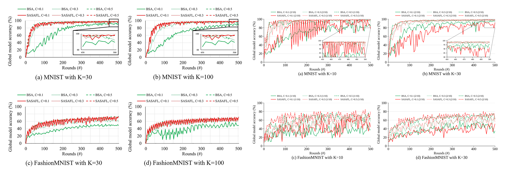
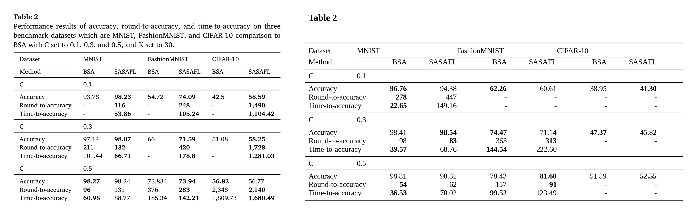

# E1. MNIST — Table 2(MNIST 열), Fig. 7(a), Table 4(MNIST)

마지막 갱신: 2026-10-26 16:59

**재현 설정**: K=30, wise-175 단일 노드, CPU 카테고리 1·2·3·4·8코어 × 6명(논문 K=30 구성), batch 32, local epoch 5, τ=9, ζ=0.9, non-IID(gaussian), 설정당 반복 10회 목표(논문: average of ten repetitions)

## 비교 그림 (왼쪽: 논문 원본, 오른쪽: 재현)

## 반복 실행 상태 (그림은 완료된 반복의 평균 곡선, 표는 반복별 값의 평균)

| 설정 (1회차 이름) | 방법 | C | 완료 반복 | 최고 정확도 평균 ± 표준편차 | 소요 평균(분) |
|---|---|---:|---:|---:|---:|
| `T2_MNIST_BSA_C0.1_single_cats12348` | BSA | 0.1 | 2/10 | 96.76 ± 0.14 | 40 |
| `T2_MNIST_BSA_C0.3_single_cats12348` | BSA | 0.3 | 2/10 | 98.41 ± 0.12 | 205 |
| `T2_MNIST_BSA_C0.5_single_cats12348` | BSA | 0.5 | 2/10 | 98.81 ± 0.05 | 341 |
| `T2_MNIST_SASAFL_C0.1_single_cats12348` | SASAFL | 0.1 | 2/10 | 94.38 ± 0.81 | 153 |
| `T2_MNIST_SASAFL_C0.3_single_cats12348` | SASAFL | 0.3 | 2/10 | 98.54 ± 0.01 | 400 |
| `T2_MNIST_SASAFL_C0.5_single_cats12348` | SASAFL | 0.5 | 2/10 | 98.81 ± 0.02 | 594 |

반복 값 파일: `repeats/runs_index.csv`(실행별), `repeats/summary_by_setting.csv`(설정별 평균·표준편차), `repeats/curves/<설정>.csv`(라운드별 회차 값과 평균)

## Table 2 비교

| MNIST (목표 95%) | 논문 BSA | 논문 SASAFL | 재현 BSA | 재현 SASAFL |
|---|---:|---:|---:|---:|
| **C = 0.1** | | | | |
| Accuracy | 93.78 | **98.23** | **96.76** | 94.38 |
| Round-to-accuracy | - | **116** | **278** | 447 |
| Time-to-accuracy | - | **53.86** | **22.65** | 149.16 |
| **C = 0.3** | | | | |
| Accuracy | 97.14 | **98.07** | 98.41 | **98.54** |
| Round-to-accuracy | 211 | **132** | 98 | **83** |
| Time-to-accuracy | 101.44 | **66.71** | **39.57** | 68.76 |
| **C = 0.5** | | | | |
| Accuracy | **98.27** | 98.24 | 98.81 | 98.81 |
| Round-to-accuracy | **96** | 131 | **54** | 62 |
| Time-to-accuracy | **60.98** | 88.77 | **36.53** | 78.02 |

주의:
- T2_MNIST_BSA_C0.1_single_cats12348: 완료 반복 2/10 (완료된 반복만 평균)
- T2_MNIST_BSA_C0.3_single_cats12348: 완료 반복 2/10 (완료된 반복만 평균)
- T2_MNIST_BSA_C0.5_single_cats12348: 완료 반복 2/10 (완료된 반복만 평균)
- T2_MNIST_SASAFL_C0.1_single_cats12348: 완료 반복 2/10 (완료된 반복만 평균)
- T2_MNIST_SASAFL_C0.3_single_cats12348: 완료 반복 2/10 (완료된 반복만 평균)
- T2_MNIST_SASAFL_C0.5_single_cats12348: 완료 반복 2/10 (완료된 반복만 평균)

- Accuracy = 최고 test 정확도, Round-to-accuracy = 목표 첫 도달 라운드, Time-to-accuracy = 서버 setup 시작부터 목표 도달까지(분). `-` = 도달 못 함/미실행
- Time-to-accuracy는 단일 노드 과다 할당(thread 109개 / 논리 CPU 32개) 환경이라 논문과 절대값 비교가 어렵다.

### 관찰

- C=0.1: 정확도 차이(SASAFL−BSA) 논문 +4.45%p, 재현 -2.39%p → **논문과 반대 방향**
  - round-to-accuracy BSA/SASAFL = 0.62배 (논문 BSA 미도달) → 1보다 크면 SASAFL이 더 빨리 도달
- C=0.3: 정확도 차이(SASAFL−BSA) 논문 +0.93%p, 재현 +0.13%p → 논문과 같은 방향
  - round-to-accuracy BSA/SASAFL = 1.19배 (논문 1.60배) → 1보다 크면 SASAFL이 더 빨리 도달
- C=0.5: 정확도 차이(SASAFL−BSA) 논문 -0.03%p, 재현 +0.00%p → 논문과 같은 방향
  - round-to-accuracy BSA/SASAFL = 0.87배 (논문 0.73배) → 1보다 크면 SASAFL이 더 빨리 도달

## Table 4 (K=30 행)

SASAFL로 300라운드를 마치는 데 걸린 시간(분).

|  | C=0.1 | C=0.3 | C=0.5 |
|---|---:|---:|---:|
| 논문 K=30 (300R) | 139 | 151 | 204 |
| 재현 K=30 (300R) | 95 | 250 | 378 |

<!-- /table4 -->

