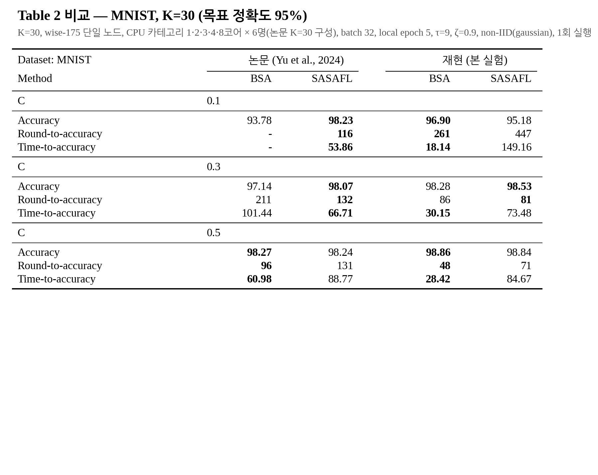
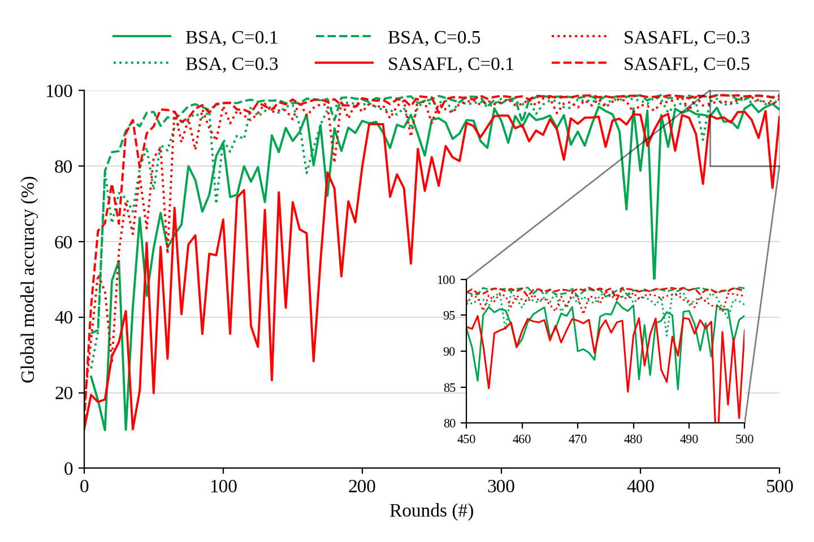
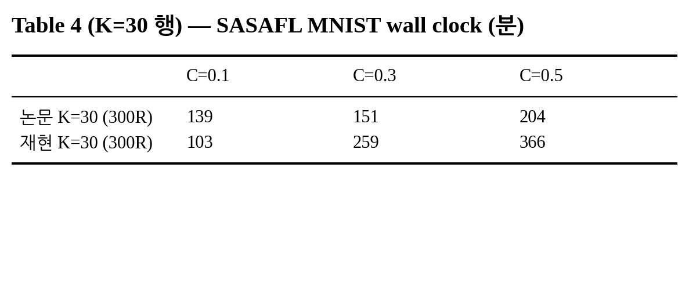

# E1. MNIST — Table 2(MNIST 열), Fig. 7(a), Table 4(MNIST)

마지막 갱신: 2026-10-12 10:21

**재현 설정**: K=30, wise-175 단일 노드, CPU 카테고리 1·2·3·4·8코어 × 6명(논문 K=30 구성), batch 32, local epoch 5, τ=9, ζ=0.9, non-IID(gaussian), 1회 실행

## 실행 상태

| 실행 | 방법 | C | 상태 | 소요(분) |
|---|---|---:|---|---:|
| `T2_MNIST_BSA_C0.1_single_cats12348` | BSA | 0.1 | 완료: 500/500라운드 | 37.8 |
| `T2_MNIST_BSA_C0.3_single_cats12348` | BSA | 0.3 | 완료: 500/500라운드 | 181.1 |
| `T2_MNIST_BSA_C0.5_single_cats12348` | BSA | 0.5 | 완료: 500/500라운드 | 318.0 |
| `T2_MNIST_SASAFL_C0.1_single_cats12348` | SASAFL | 0.1 | 완료: 500/500라운드 | 163.9 |
| `T2_MNIST_SASAFL_C0.3_single_cats12348` | SASAFL | 0.3 | 완료: 500/500라운드 | 413.0 |
| `T2_MNIST_SASAFL_C0.5_single_cats12348` | SASAFL | 0.5 | 완료: 500/500라운드 | 560.8 |

## Table 2 비교

| MNIST (목표 95%) | 논문 BSA | 논문 SASAFL | 재현 BSA | 재현 SASAFL |
|---|---:|---:|---:|---:|
| **C = 0.1** | | | | |
| Accuracy | 93.78 | **98.23** | **96.90** | 95.18 |
| Round-to-accuracy | - | **116** | **261** | 447 |
| Time-to-accuracy | - | **53.86** | **18.14** | 149.16 |
| **C = 0.3** | | | | |
| Accuracy | 97.14 | **98.07** | 98.28 | **98.53** |
| Round-to-accuracy | 211 | **132** | 86 | **81** |
| Time-to-accuracy | 101.44 | **66.71** | **30.15** | 73.48 |
| **C = 0.5** | | | | |
| Accuracy | **98.27** | 98.24 | **98.86** | 98.84 |
| Round-to-accuracy | **96** | 131 | **48** | 71 |
| Time-to-accuracy | **60.98** | 88.77 | **28.42** | 84.67 |

- Accuracy = 최고 test 정확도, Round-to-accuracy = 목표 첫 도달 라운드, Time-to-accuracy = 서버 setup 시작부터 목표 도달까지(분). `-` = 도달 못 함/미실행
- Time-to-accuracy는 단일 노드 과다 할당(thread 109개 / 논리 CPU 32개) 환경이라 논문과 절대값 비교가 어렵다.

### 관찰

- C=0.1: 정확도 차이(SASAFL−BSA) 논문 +4.45%p, 재현 -1.72%p → **논문과 반대 방향**
  - round-to-accuracy BSA/SASAFL = 0.58배 (논문 BSA 미도달) → 1보다 크면 SASAFL이 더 빨리 도달
- C=0.3: 정확도 차이(SASAFL−BSA) 논문 +0.93%p, 재현 +0.25%p → 논문과 같은 방향
  - round-to-accuracy BSA/SASAFL = 1.06배 (논문 1.60배) → 1보다 크면 SASAFL이 더 빨리 도달
- C=0.5: 정확도 차이(SASAFL−BSA) 논문 -0.03%p, 재현 -0.02%p → 논문과 같은 방향
  - round-to-accuracy BSA/SASAFL = 0.68배 (논문 0.73배) → 1보다 크면 SASAFL이 더 빨리 도달

## Fig. 7(a) — MNIST, K=30 (5라운드 간격)

## Table 4 (K=30 행)

SASAFL로 300라운드를 마치는 데 걸린 시간(분).

|  | C=0.1 | C=0.3 | C=0.5 |
|---|---:|---:|---:|
| 논문 K=30 (300R) | 139 | 151 | 204 |
| 재현 K=30 (300R) | 103 | 259 | 366 |

