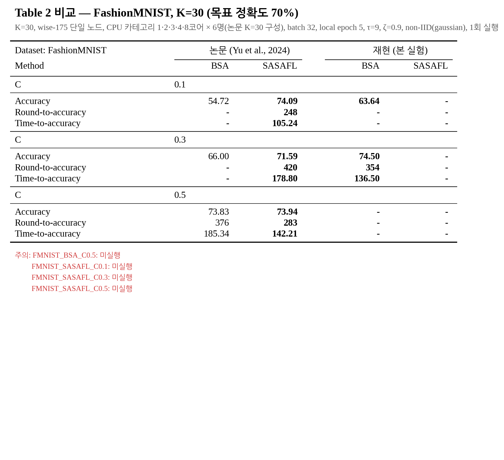
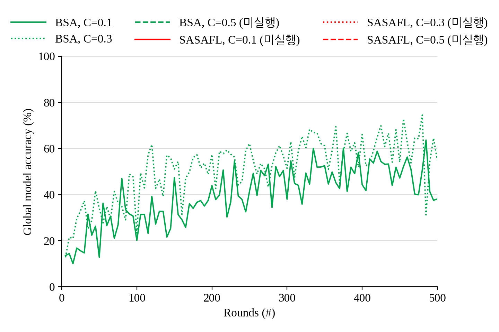
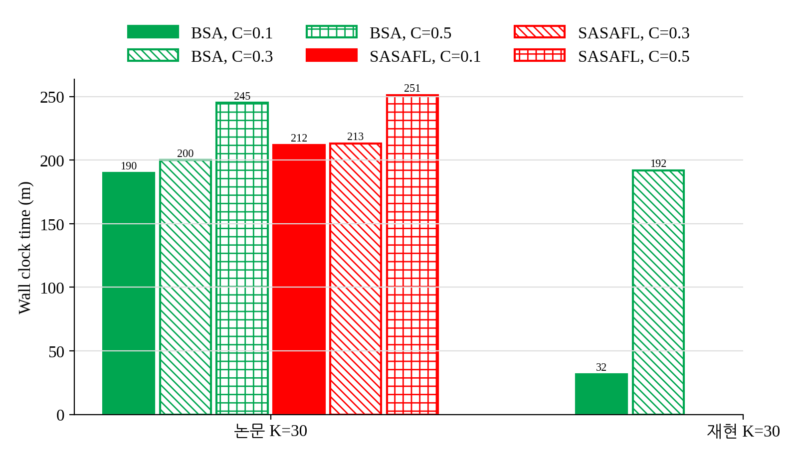
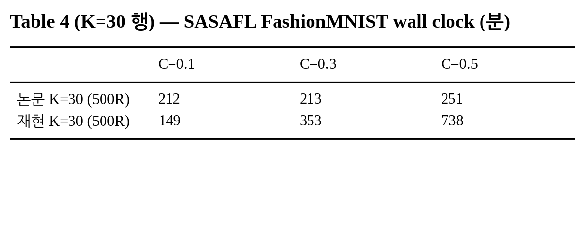

# E2. FashionMNIST — Table 2(FashionMNIST 열), Fig. 7(c), Fig. 11(K=30), Table 4(FashionMNIST)

마지막 갱신: 2026-10-12 13:32

**재현 설정**: K=30, wise-175 단일 노드, CPU 카테고리 1·2·3·4·8코어 × 6명(논문 K=30 구성), batch 32, local epoch 5, τ=9, ζ=0.9, non-IID(gaussian), 1회 실행

## 실행 상태

| 실행 | 방법 | C | 상태 | 소요(분) |
|---|---|---:|---|---:|
| `FMNIST_BSA_C0.1` | BSA | 0.1 | 완료: 500/500라운드 | 31.7 |
| `FMNIST_BSA_C0.3` | BSA | 0.3 | 완료: 500/500라운드 | 192.0 |
| `FMNIST_BSA_C0.5` | BSA | 0.5 | 미실행 | - |
| `FMNIST_SASAFL_C0.1` | SASAFL | 0.1 | 미실행 | - |
| `FMNIST_SASAFL_C0.3` | SASAFL | 0.3 | 미실행 | - |
| `FMNIST_SASAFL_C0.5` | SASAFL | 0.5 | 미실행 | - |

## Table 2 비교

| FashionMNIST (목표 70%) | 논문 BSA | 논문 SASAFL | 재현 BSA | 재현 SASAFL |
|---|---:|---:|---:|---:|
| **C = 0.1** | | | | |
| Accuracy | 54.72 | **74.09** | **63.64** | - |
| Round-to-accuracy | - | **248** | - | - |
| Time-to-accuracy | - | **105.24** | - | - |
| **C = 0.3** | | | | |
| Accuracy | 66.00 | **71.59** | **74.50** | - |
| Round-to-accuracy | - | **420** | **354** | - |
| Time-to-accuracy | - | **178.80** | **136.50** | - |
| **C = 0.5** | | | | |
| Accuracy | 73.83 | **73.94** | - | - |
| Round-to-accuracy | 376 | **283** | - | - |
| Time-to-accuracy | 185.34 | **142.21** | - | - |

주의:
- FMNIST_BSA_C0.5: 미실행
- FMNIST_SASAFL_C0.1: 미실행
- FMNIST_SASAFL_C0.3: 미실행
- FMNIST_SASAFL_C0.5: 미실행

- Accuracy = 최고 test 정확도, Round-to-accuracy = 목표 첫 도달 라운드, Time-to-accuracy = 서버 setup 시작부터 목표 도달까지(분). `-` = 도달 못 함/미실행
- Time-to-accuracy는 단일 노드 과다 할당(thread 109개 / 논리 CPU 32개) 환경이라 논문과 절대값 비교가 어렵다.

## Fig. 7(c) — FashionMNIST, K=30 (5라운드 간격)

## Fig. 11 — FashionMNIST 500라운드 wall clock (K=30)

논문 BSA 값은 그림에서 읽은 근사값, 논문 SASAFL 값은 Table 4와 같다.

## Table 4 (K=30 행)

SASAFL로 500라운드를 마치는 데 걸린 시간(분).

|  | C=0.1 | C=0.3 | C=0.5 |
|---|---:|---:|---:|
| 논문 K=30 (500R) | 212 | 213 | 251 |
| 재현 K=30 (500R) | - | - | - |

