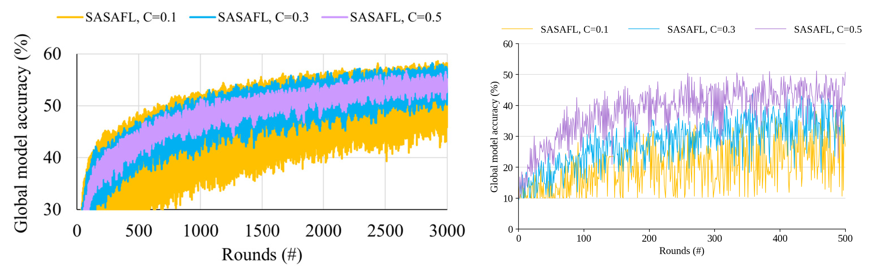

# E4. CIFAR-10 — Table 2(CIFAR-10 열), Fig. 8(a), Fig. 9, Table 4(CIFAR-10)

마지막 갱신: 2026-10-16 13:25

**재현 설정**: K=30, wise-175 단일 노드, CPU 카테고리 1·2·3·4·8코어 × 6명(논문 K=30 구성), batch 32, local epoch 5, τ=9, ζ=0.9, non-IID(gaussian), 1회 실행

## 비교 그림 (왼쪽: 논문 원본, 오른쪽: 재현)

## 실행 상태

| 실행 | 방법 | C | 상태 | 소요(분) |
|---|---|---:|---|---:|
| `CIFAR10_BSA_C0.1` | BSA | 0.1 | 완료: 500/500라운드 | 35.7 |
| `CIFAR10_BSA_C0.3` | BSA | 0.3 | 완료: 500/500라운드 | 185.9 |
| `CIFAR10_BSA_C0.5` | BSA | 0.5 | 완료: 500/500라운드 | 307.6 |
| `CIFAR10_SASAFL_C0.1` | SASAFL | 0.1 | 완료: 500/500라운드 | 157.9 |
| `CIFAR10_SASAFL_C0.3` | SASAFL | 0.3 | 완료: 500/500라운드 | 287.0 |
| `CIFAR10_SASAFL_C0.5` | SASAFL | 0.5 | 완료: 500/500라운드 | 491.2 |

## Table 2 비교

| CIFAR10 (목표 55%) | 논문 BSA | 논문 SASAFL | 재현 BSA | 재현 SASAFL |
|---|---:|---:|---:|---:|
| **C = 0.1** | | | | |
| Accuracy | 42.50 | **58.59** | 36.50 | **38.28** |
| Round-to-accuracy | - | **1,490** | - | - |
| Time-to-accuracy | - | **1,104.42** | - | - |
| **C = 0.3** | | | | |
| Accuracy | 51.08 | **58.25** | **47.92** | 44.35 |
| Round-to-accuracy | - | **1,728** | - | - |
| Time-to-accuracy | - | **1,281.03** | - | - |
| **C = 0.5** | | | | |
| Accuracy | **56.82** | 56.77 | **52.80** | 51.14 |
| Round-to-accuracy | 2,348 | **2,140** | - | - |
| Time-to-accuracy | 1,809.73 | **1,680.49** | - | - |

- Accuracy = 최고 test 정확도, Round-to-accuracy = 목표 첫 도달 라운드, Time-to-accuracy = 서버 setup 시작부터 목표 도달까지(분). `-` = 도달 못 함/미실행
- Time-to-accuracy는 단일 노드 과다 할당(thread 109개 / 논리 CPU 32개) 환경이라 논문과 절대값 비교가 어렵다.

### 관찰

- C=0.1: 정확도 차이(SASAFL−BSA) 논문 +16.09%p, 재현 +1.78%p → 논문과 같은 방향
- C=0.3: 정확도 차이(SASAFL−BSA) 논문 +7.17%p, 재현 -3.57%p → **논문과 반대 방향**
- C=0.5: 정확도 차이(SASAFL−BSA) 논문 -0.05%p, 재현 -1.66%p → 논문과 같은 방향

**라운드 축소**: 논문은 CIFAR-10을 3000라운드 돌렸지만 여기서는 500라운드로 고정했다. 그래서 논문 그림과는 0~500라운드 구간만 비교할 수 있다.

## Table 4 (K=30 행)

SASAFL로 500라운드를 마치는 데 걸린 시간(분). **주의: 논문은 1000라운드 기준, 재현은 500라운드 기준이라 직접 비교 불가 (라운드당 시간 비교용: 논문 1000R 값을 500/1000배 하면 대략적인 기준이 된다).**

|  | C=0.1 | C=0.3 | C=0.5 |
|---|---:|---:|---:|
| 논문 K=30 (1000R) | 741 | 742 | 787 |
| 재현 K=30 (500R) | 158 | 287 | 491 |

<!-- /table4 -->

