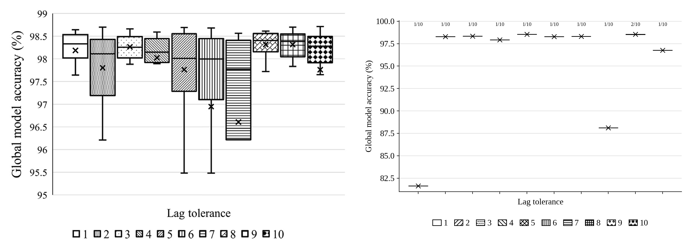
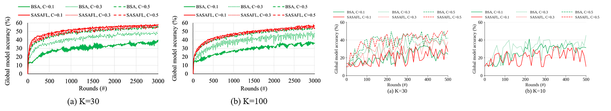
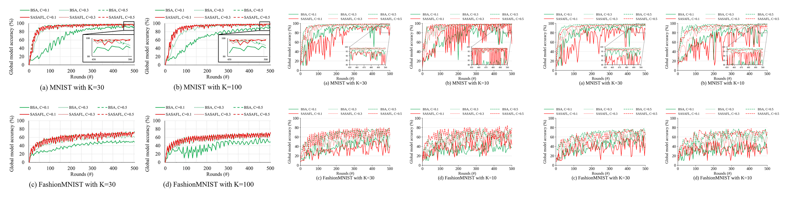

# E6. 최종 종합 — Table 2(3개 데이터셋), Table 4(K=30), 결론 수치 점검

마지막 갱신: 2026-10-21 10:24

**재현 설정**: K=30, wise-175 단일 노드, CPU 카테고리 1·2·3·4·8코어 × 6명(논문 K=30 구성), batch 32, local epoch 5, τ=9, ζ=0.9, non-IID(gaussian), 1회 실행

## 비교 그림 (왼쪽: 논문 원본, 오른쪽: 재현)

## Table 2 전체 (K=30)

| MNIST (목표 95%) | 논문 BSA | 논문 SASAFL | 재현 BSA | 재현 SASAFL |
|---|---:|---:|---:|---:|
| **C = 0.1** | | | | |
| Accuracy | 93.78 | **98.23** | **96.90** | 95.18 |
| Round-to-accuracy | - | **116** | **261** | 447 |
| Time-to-accuracy | - | **53.86** | **18.14** | 149.16 |
| **C = 0.3** | | | | |
| Accuracy | 97.14 | **98.07** | 98.28 | **98.53** |
| Round-to-accuracy | 211 | **132** | 86 | **81** |
| Time-to-accuracy | 101.44 | **66.71** | **30.15** | 73.48 |
| **C = 0.5** | | | | |
| Accuracy | **98.27** | 98.24 | **98.86** | 98.84 |
| Round-to-accuracy | **96** | 131 | **48** | 71 |
| Time-to-accuracy | **60.98** | 88.77 | **28.42** | 84.67 |

| FashionMNIST (목표 70%) | 논문 BSA | 논문 SASAFL | 재현 BSA | 재현 SASAFL |
|---|---:|---:|---:|---:|
| **C = 0.1** | | | | |
| Accuracy | 54.72 | **74.09** | **63.64** | 59.72 |
| Round-to-accuracy | - | **248** | - | - |
| Time-to-accuracy | - | **105.24** | - | - |
| **C = 0.3** | | | | |
| Accuracy | 66.00 | **71.59** | **74.50** | 69.93 |
| Round-to-accuracy | - | **420** | **354** | - |
| Time-to-accuracy | - | **178.80** | **136.50** | - |
| **C = 0.5** | | | | |
| Accuracy | 73.83 | **73.94** | 79.57 | **81.36** |
| Round-to-accuracy | 376 | **283** | 118 | **98** |
| Time-to-accuracy | 185.34 | **142.21** | **73.10** | 137.88 |

| CIFAR10 (목표 55%) | 논문 BSA | 논문 SASAFL | 재현 BSA | 재현 SASAFL |
|---|---:|---:|---:|---:|
| **C = 0.1** | | | | |
| Accuracy | 42.50 | **58.59** | 36.50 | **38.28** |
| Round-to-accuracy | - | **1,490** | - | - |
| Time-to-accuracy | - | **1,104.42** | - | - |
| **C = 0.3** | | | | |
| Accuracy | 51.08 | **58.25** | **47.92** | 44.35 |
| Round-to-accuracy | - | **1,728** | - | - |
| Time-to-accuracy | - | **1,281.03** | - | - |
| **C = 0.5** | | | | |
| Accuracy | **56.82** | 56.77 | **52.80** | 51.14 |
| Round-to-accuracy | 2,348 | **2,140** | - | - |
| Time-to-accuracy | 1,809.73 | **1,680.49** | - | - |

## Table 4 (K=30 행)

SASAFL로 300라운드를 마치는 데 걸린 시간(분).

|  | C=0.1 | C=0.3 | C=0.5 |
|---|---:|---:|---:|
| 논문 K=30 (300R) | 139 | 151 | 204 |
| 재현 K=30 (300R) | 103 | 259 | 366 |

SASAFL로 500라운드를 마치는 데 걸린 시간(분).

|  | C=0.1 | C=0.3 | C=0.5 |
|---|---:|---:|---:|
| 논문 K=30 (500R) | 212 | 213 | 251 |
| 재현 K=30 (500R) | 149 | 353 | 738 |

SASAFL로 500라운드를 마치는 데 걸린 시간(분). **주의: 논문은 1000라운드 기준, 재현은 500라운드 기준이라 직접 비교 불가 (라운드당 시간 비교용: 논문 1000R 값을 500/1000배 하면 대략적인 기준이 된다).**

|  | C=0.1 | C=0.3 | C=0.5 |
|---|---:|---:|---:|
| 논문 K=30 (1000R) | 741 | 742 | 787 |
| 재현 K=30 (500R) | 158 | 287 | 491 |

## 결론 수치 점검

| 결론의 주장 | 논문 출처 | 이 장비에서 재현 |
|---|---|---|
| 최대 19.69%p 높은 정확도 | Table 3 (K=100) CIFAR-10, C=0.1: 57.95 - 38.26 | 불가 (K=100) |
| round-to-accuracy 2.32배 | Table 3 (K=100) MNIST, C=0.3: 244 / 105 | 불가 (K=100) |
| time-to-accuracy 2.24배 | Table 3 (K=100) MNIST, C=0.3: 131.37 / 58.5 | 불가 (K=100) |

K=30에서 같은 지표(재현값, 논문 K=30 값):

- MNIST C=0.1: 정확도 차이 재현 -1.72%p (논문 +4.45%p), RTA 배수 재현 0.58 (논문 -), TTA 배수 재현 0.12 (논문 -)
- MNIST C=0.3: 정확도 차이 재현 +0.25%p (논문 +0.93%p), RTA 배수 재현 1.06 (논문 1.60), TTA 배수 재현 0.41 (논문 1.52)
- MNIST C=0.5: 정확도 차이 재현 -0.02%p (논문 -0.03%p), RTA 배수 재현 0.68 (논문 0.73), TTA 배수 재현 0.34 (논문 0.69)
- FashionMNIST C=0.1: 정확도 차이 재현 -3.92%p (논문 +19.37%p), RTA 배수 재현 - (논문 -), TTA 배수 재현 - (논문 -)
- FashionMNIST C=0.3: 정확도 차이 재현 -4.57%p (논문 +5.59%p), RTA 배수 재현 - (논문 -), TTA 배수 재현 - (논문 -)
- FashionMNIST C=0.5: 정확도 차이 재현 +1.79%p (논문 +0.11%p), RTA 배수 재현 1.20 (논문 1.33), TTA 배수 재현 0.53 (논문 1.30)
- CIFAR10 C=0.1: 정확도 차이 재현 +1.78%p (논문 +16.09%p), RTA 배수 재현 - (논문 -), TTA 배수 재현 - (논문 -)
- CIFAR10 C=0.3: 정확도 차이 재현 -3.57%p (논문 +7.17%p), RTA 배수 재현 - (논문 -), TTA 배수 재현 - (논문 -)
- CIFAR10 C=0.5: 정확도 차이 재현 -1.66%p (논문 -0.05%p), RTA 배수 재현 - (논문 1.10), TTA 배수 재현 - (논문 1.08)

## 이 장비로 재현하지 못한 항목

- K=100: Table 3, Fig. 6, Table 1, Fig. 7(b)(d), Fig. 8(b), Fig. 10, Table 4의 K≥100 행
- 이유: 논문 K=100 카테고리(1·2·3·5·8코어 × 20명)는 노드당 190 thread가 필요하다. 두 노드(각 논리 32)로 시도한 실행은 실패했다(../../crash_study, ../README.md 참고).

