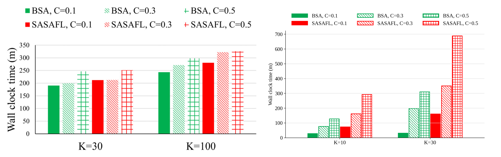
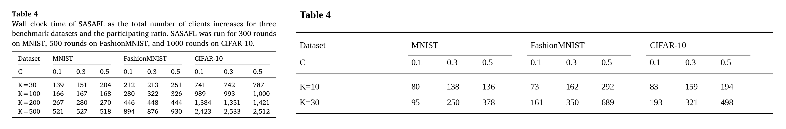
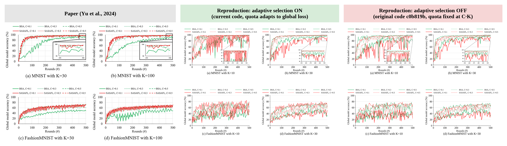
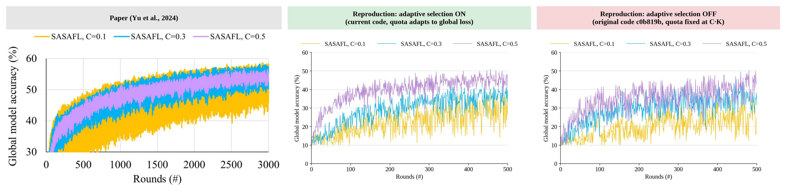

# E8. K=10 — 논문의 K=100 칸 대신 (Fig. 7(b)(d), Fig. 8(b), Fig. 11, Table 4 K=10 행). BSA · SASAFL(현재 코드) · SASAFL(원저자 코드, quota 고정)

마지막 갱신: 2026-10-26 10:08

**재현 설정**: K=10, wise-175 단일 노드, CPU 카테고리 1·2·3·4·8코어 × 2명(논문 K=10 구성), batch 32, local epoch 5, τ=9, ζ=0.9, non-IID(gaussian), 설정당 반복 10회 목표(논문: average of ten repetitions)

## 비교 그림 (왼쪽: 논문 원본, 오른쪽: 재현)

## 반복 실행 상태 (그림은 완료된 반복의 평균 곡선, 표는 반복별 값의 평균)

| 설정 (1회차 이름) | 방법 | C | 완료 반복 | 최고 정확도 평균 ± 표준편차 | 소요 평균(분) |
|---|---|---:|---:|---:|---:|
| `K10_MNIST_BSA_C0.1` | BSA | 0.1 | 1/10 | 94.69 ± 0.00 | 38 |
| `K10_MNIST_SASAFL_C0.1` | SASAFL | 0.1 | 1/10 | 98.60 ± 0.00 | 143 |
| `K10_MNIST_SASAFLorig_C0.1` | SASAFLorig | 0.1 | 1/10 | 94.40 ± 0.00 | 72 |
| `K10_MNIST_BSA_C0.3` | BSA | 0.3 | 1/10 | 97.90 ± 0.00 | 88 |
| `K10_MNIST_SASAFL_C0.3` | SASAFL | 0.3 | 1/10 | 98.88 ± 0.00 | 197 |
| `K10_MNIST_SASAFLorig_C0.3` | SASAFLorig | 0.3 | 1/10 | 96.66 ± 0.00 | 117 |
| `K10_MNIST_BSA_C0.5` | BSA | 0.5 | 1/10 | 98.71 ± 0.00 | 150 |
| `K10_MNIST_SASAFL_C0.5` | SASAFL | 0.5 | 1/10 | 98.85 ± 0.00 | 221 |
| `K10_MNIST_SASAFLorig_C0.5` | SASAFLorig | 0.5 | 1/10 | 98.40 ± 0.00 | 181 |
| `K10_FMNIST_BSA_C0.1` | BSA | 0.1 | 1/10 | 55.48 ± 0.00 | 29 |
| `K10_FMNIST_SASAFL_C0.1` | SASAFL | 0.1 | 1/10 | 69.59 ± 0.00 | 73 |
| `K10_FMNIST_SASAFLorig_C0.1` | SASAFLorig | 0.1 | 1/10 | 55.59 ± 0.00 | 75 |
| `K10_FMNIST_BSA_C0.3` | BSA | 0.3 | 1/10 | 74.91 ± 0.00 | 76 |
| `K10_FMNIST_SASAFL_C0.3` | SASAFL | 0.3 | 1/10 | 79.10 ± 0.00 | 162 |
| `K10_FMNIST_SASAFLorig_C0.3` | SASAFLorig | 0.3 | 1/10 | 70.12 ± 0.00 | 106 |
| `K10_FMNIST_BSA_C0.5` | BSA | 0.5 | 1/10 | 78.88 ± 0.00 | 128 |
| `K10_FMNIST_SASAFL_C0.5` | SASAFL | 0.5 | 1/10 | 84.87 ± 0.00 | 293 |
| `K10_FMNIST_SASAFLorig_C0.5` | SASAFLorig | 0.5 | 1/10 | 80.34 ± 0.00 | 156 |
| `K10_CIFAR10_BSA_C0.1` | BSA | 0.1 | 1/10 | 43.59 ± 0.00 | 35 |
| `K10_CIFAR10_SASAFL_C0.1` | SASAFL | 0.1 | 1/10 | 35.92 ± 0.00 | 83 |
| `K10_CIFAR10_SASAFLorig_C0.1` | SASAFLorig | 0.1 | 1/10 | 47.04 ± 0.00 | 74 |
| `K10_CIFAR10_BSA_C0.3` | BSA | 0.3 | 1/10 | 45.36 ± 0.00 | 87 |
| `K10_CIFAR10_SASAFL_C0.3` | SASAFL | 0.3 | 1/10 | 48.76 ± 0.00 | 159 |
| `K10_CIFAR10_SASAFLorig_C0.3` | SASAFLorig | 0.3 | 1/10 | 47.11 ± 0.00 | 117 |
| `K10_CIFAR10_BSA_C0.5` | BSA | 0.5 | 1/10 | 51.99 ± 0.00 | 178 |
| `K10_CIFAR10_SASAFL_C0.5` | SASAFL | 0.5 | 1/10 | 51.94 ± 0.00 | 194 |
| `K10_CIFAR10_SASAFLorig_C0.5` | SASAFLorig | 0.5 | 1/10 | 48.46 ± 0.00 | 216 |

반복 값 파일: `repeats/runs_index.csv`(실행별), `repeats/summary_by_setting.csv`(설정별 평균·표준편차), `repeats/curves/<설정>.csv`(라운드별 회차 값과 평균)

## 무엇을 돌렸나

- 논문은 K=30과 K=100을 비교했지만 이 장비에서 K=100은 돌릴 수 없어 K=10으로 대신한다. 그림·표에서 논문의 K=100 칸 자리에 K=10을 넣었다(왼쪽 논문 원본은 K=100 그대로).
- K=10 클라이언트는 K=30과 같은 CPU 카테고리(1·2·3·4·8코어)를 2명씩 쓴다. 나머지 설정은 K=30과 같다.
- SASAFL은 현재 코드(quota 적응 동작)와 원저자 코드(c0b819b, quota 고정) 둘 다 돌렸다.

## 실행 상태

| 설정 (1회차 이름) | 방법 | C | 완료 반복 | 최고 정확도 평균 ± 표준편차 | 소요 평균(분) |
|---|---|---:|---:|---:|---:|
| `K10_MNIST_BSA_C0.1` | BSA | 0.1 | 1/10 | 94.69 ± 0.00 | 38 |
| `K10_MNIST_SASAFL_C0.1` | SASAFL | 0.1 | 1/10 | 98.60 ± 0.00 | 143 |
| `K10_MNIST_SASAFLorig_C0.1` | SASAFLorig | 0.1 | 1/10 | 94.40 ± 0.00 | 72 |
| `K10_MNIST_BSA_C0.3` | BSA | 0.3 | 1/10 | 97.90 ± 0.00 | 88 |
| `K10_MNIST_SASAFL_C0.3` | SASAFL | 0.3 | 1/10 | 98.88 ± 0.00 | 197 |
| `K10_MNIST_SASAFLorig_C0.3` | SASAFLorig | 0.3 | 1/10 | 96.66 ± 0.00 | 117 |
| `K10_MNIST_BSA_C0.5` | BSA | 0.5 | 1/10 | 98.71 ± 0.00 | 150 |
| `K10_MNIST_SASAFL_C0.5` | SASAFL | 0.5 | 1/10 | 98.85 ± 0.00 | 221 |
| `K10_MNIST_SASAFLorig_C0.5` | SASAFLorig | 0.5 | 1/10 | 98.40 ± 0.00 | 181 |
| `K10_FMNIST_BSA_C0.1` | BSA | 0.1 | 1/10 | 55.48 ± 0.00 | 29 |
| `K10_FMNIST_SASAFL_C0.1` | SASAFL | 0.1 | 1/10 | 69.59 ± 0.00 | 73 |
| `K10_FMNIST_SASAFLorig_C0.1` | SASAFLorig | 0.1 | 1/10 | 55.59 ± 0.00 | 75 |
| `K10_FMNIST_BSA_C0.3` | BSA | 0.3 | 1/10 | 74.91 ± 0.00 | 76 |
| `K10_FMNIST_SASAFL_C0.3` | SASAFL | 0.3 | 1/10 | 79.10 ± 0.00 | 162 |
| `K10_FMNIST_SASAFLorig_C0.3` | SASAFLorig | 0.3 | 1/10 | 70.12 ± 0.00 | 106 |
| `K10_FMNIST_BSA_C0.5` | BSA | 0.5 | 1/10 | 78.88 ± 0.00 | 128 |
| `K10_FMNIST_SASAFL_C0.5` | SASAFL | 0.5 | 1/10 | 84.87 ± 0.00 | 293 |
| `K10_FMNIST_SASAFLorig_C0.5` | SASAFLorig | 0.5 | 1/10 | 80.34 ± 0.00 | 156 |
| `K10_CIFAR10_BSA_C0.1` | BSA | 0.1 | 1/10 | 43.59 ± 0.00 | 35 |
| `K10_CIFAR10_SASAFL_C0.1` | SASAFL | 0.1 | 1/10 | 35.92 ± 0.00 | 83 |
| `K10_CIFAR10_SASAFLorig_C0.1` | SASAFLorig | 0.1 | 1/10 | 47.04 ± 0.00 | 74 |
| `K10_CIFAR10_BSA_C0.3` | BSA | 0.3 | 1/10 | 45.36 ± 0.00 | 87 |
| `K10_CIFAR10_SASAFL_C0.3` | SASAFL | 0.3 | 1/10 | 48.76 ± 0.00 | 159 |
| `K10_CIFAR10_SASAFLorig_C0.3` | SASAFLorig | 0.3 | 1/10 | 47.11 ± 0.00 | 117 |
| `K10_CIFAR10_BSA_C0.5` | BSA | 0.5 | 1/10 | 51.99 ± 0.00 | 178 |
| `K10_CIFAR10_SASAFL_C0.5` | SASAFL | 0.5 | 1/10 | 51.94 ± 0.00 | 194 |
| `K10_CIFAR10_SASAFLorig_C0.5` | SASAFLorig | 0.5 | 1/10 | 48.46 ± 0.00 | 216 |

## 최고 정확도 (500라운드)

| 데이터셋 | C | BSA | SASAFL 현재 코드 | SASAFL 원저자 코드 | 원저자 코드 quota: 범위 / 서로 다른 값 수 / int(C·K) 비율 |
|---|---:|---:|---:|---:|---|
| MNIST | 0.1 | 94.69 | 98.60 | 94.40 | 1–1 / 1 / 100% |
| MNIST | 0.3 | 97.90 | 98.88 | 96.66 | 3–3 / 1 / 100% |
| MNIST | 0.5 | 98.71 | 98.85 | 98.40 | 5–5 / 1 / 100% |
| FashionMNIST | 0.1 | 55.48 | 69.59 | 55.59 | 1–1 / 1 / 100% |
| FashionMNIST | 0.3 | 74.91 | 79.10 | 70.12 | 3–3 / 1 / 100% |
| FashionMNIST | 0.5 | 78.88 | 84.87 | 80.34 | 5–5 / 1 / 100% |
| CIFAR10 | 0.1 | 43.59 | 35.92 | 47.04 | 1–1 / 1 / 100% |
| CIFAR10 | 0.3 | 45.36 | 48.76 | 47.11 | 3–3 / 1 / 100% |
| CIFAR10 | 0.5 | 51.99 | 51.94 | 48.46 | 5–5 / 1 / 100% |

